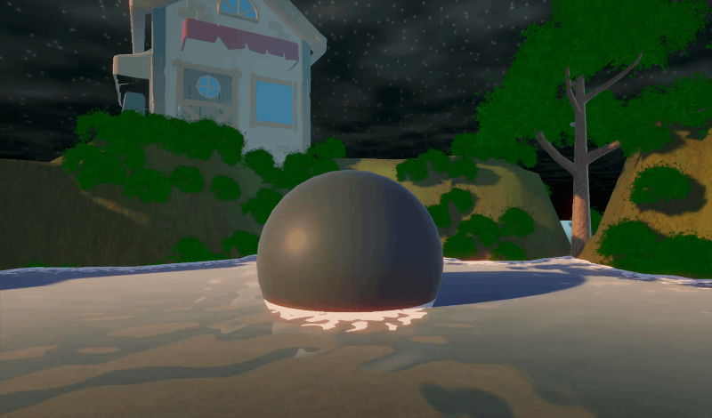

# Unity Shader Study
Unity Shader Graph를 활용한 셰이더의 기초를 학습하는 저장소입니다.

## Course
- **Lecture:** Pinous - Unity 6 Shader Graph 입문과 활용

## Course Contents
- Section 1. 강의 소개
- Section 2. Shader Graph
- Section 3. Shaders
- Section 4. Nature

## Shader Demo

## Branches
| Branch | Description |
| --- | --- |
| `shader` | Shader Graph 기초 학습 및 실습 |
| `game` | 학습 내용을 종합한 게임 프로젝트 |
