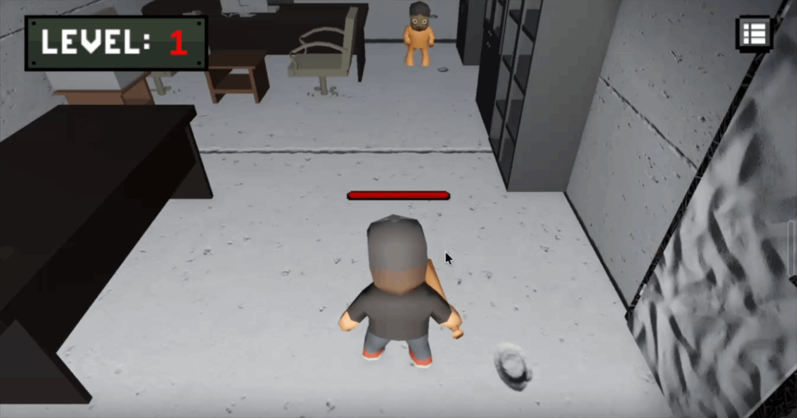

# Game Project
C#과 Unity를 활용하여 학습한 내용을 종합하고, 게임 시스템과 그래픽스 구현을 단계적으로 익히기 위한 프로젝트입니다.

## Overview
플레이어가 좀비 몬스터를 처치하고, 현재 스테이지의 모든 몬스터를 제거하면 다음 스테이지로 이동하는 3D 게임입니다.

모든 스테이지를 클리어하면 게임이 종료됩니다.

## Tech Stack

## Learning Progress

- [x] C# Programming
- [ ] Shader Graph / HLSL
- [ ] Optimization

## Code Architecture

## Gameplay Demo

