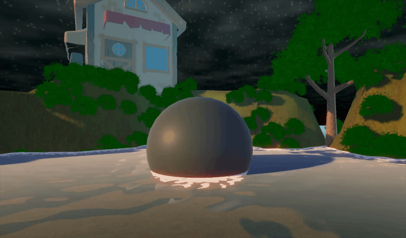

Unity Shader Graph, HLSL을 활용한 셰이더 기초 학습 저장소입니다.

## Shader Demo

## Study Topics
| Category | Sections |
|---|---|
| 강의 소개 | Sections 1 |
| Shader Graph | Section 2 |
| Shaders | Section 3 |
| Nature | Sections 4 |