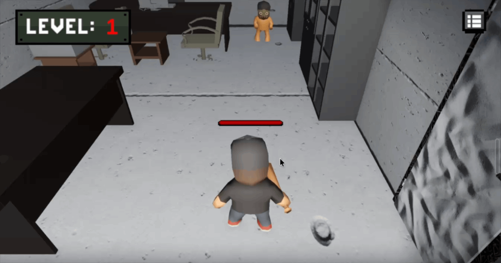

## UnityStudy_VR   [](https://unity.com/releases/unity-6)

C#과 Unity를 활용하여 학습한 내용을 종합하고, 게임 시스템과 셰이더 구현을 단계적으로 익히기 위한 프로젝트입니다. 플레이어가 좀비 몬스터를 처치하고, 현재 스테이지의 모든 몬스터를 제거하면 다음 스테이지로 이동하는 3D 게임입니다. 총 3개의 스테이지로 구성되어 있으며 모든 스테이지를 클리어하면 게임이 종료됩니다.

## Status & Prerequisites
```
Unity version: 6.3 LTS (6000.3.23f1) Apple Silicon (URP)
Platforms
Editor : macOS (Apple Silicon);
Client : macOS;
```

## Control
| 입력 | 동작 |
|---|---|
| Mouse Left Click | Attack |
| Spacebar | Activate: Magic Shield |

## Project Structure
```
UnityStudy/
├── Assets/
│   ├── Scenes/
│   ├── Scripts/
│   ├── Materials/
│   ├── Prefabs/
│   └── ...
├── Tools/
│   └── CSharpToMermaid/
├── Docs/
│   └── Architecture/
└── README.md
```

## UML Class Diagram
스크립트 폴더별 클래스를 회색 배경으로 묶고, 필드 어트리뷰트·초기값·접근 제한자와 메서드 반환형을 표시합니다. 같은 클래스 간 관계는 라벨을 유지한 채 화살표를 묶어 보여줍니다. Mermaid의 Dagre 배치를 사용합니다.

```mermaid
---
config:
  layout: dagre
  look: classic
  themeCSS: '.cluster rect { fill: #888888 !important; fill-opacity: 0.22 !important; stroke: #888888 !important; }'
---
classDiagram
direction TB
namespace ScriptsFolder_Config {
    class GameConfig {
        <<CreateAssetMenu(fileName = "GameConfig", menuName = "Config/GameConfig")>>
        -[Header("Game Settings")] [Min(500)] [SerializeField] initialEXP: int = 0
        -[Range(1, 20)] [SerializeField] initialLevel: int = 1
        +prefab: GameObject
        +InitialEXP: int
        +InitialLevel: int
    }
}
namespace ScriptsFolder_Controllers {
    class Creature {
        +Place(pos: Vector3, rot: Quaternion) void
        +TakeDamage(damage: int) void [virtual]
        -Start() void
        -Update() void
    }
    class FollowCamera {
        +player: Transform
        +offset: Vector3
        -[SerializeField] sensitivity: float = 3f
        -_yaw: float
        -LateUpdate() void
    }
    class HealthBarBillboard {
        -cam: UnityEngine.Camera
        -Start() void
        -LateUpdate() void
    }
    class Monster {
        <<RequireComponent(typeof(NavMeshAgent))>>
        -_rb: Rigidbody
        -_animator: Animator
        -[SerializeField] _detectionRadius: float = 20f
        -_player: Transform
        -_isPlayerInDetectionArea: bool = false
        -[SerializeField] _state: State = State.Idle
        -_navMeshAgent: NavMeshAgent
        -[SerializeField] maxHealth: int = 100
        -[SerializeField] healthBar: Slider
        -currentHealth: int
        -_isDead: bool
        -[SerializeField] deathEffect: ParticleSystem
        -Start() void
        -CoPerception() IEnumerator
        -CoLogic() IEnumerator
        -CheckPlayerInArea() void
        -OnDrawGizmosSelected() void
        +TakeDamage(damage: int) void
        -Die() void
        -CoFinishDeath() IEnumerator
        +ResetMonster() void
        +PlayDeathEffect() void
    }
    class ObjectBase {
        +Pooling: bool [get; set] = false
        +Awake() void [virtual]
        +init() void [virtual]
    }
    class Player {
        -_rb: Rigidbody
        -_animator: Animator
        -_testAction: InputAction
        -[SerializeField] attackDamage: int = 10
        -[SerializeField] attackIncreasePerLevel: int = 10
        -[SerializeField] attackRange: float = 1.5f
        -_hitMonster: bool
        -[SerializeField] hitEffect: ParticleSystem
        -[SerializeField] maxHealth: int = 100
        -[SerializeField] healthBar: Slider
        -_hp: int
        -_isDead: bool
        -_cam: Transform
        -[SerializeField] footstepInterval: float = 2f
        -_footstepTimer: float
        -[SerializeField] expToNextLevel: int = 100
        -[SerializeField] _magicShield: MagicShield
        +Level: int
        -CurrentExp: int
        -Start() void
        +ResetHealth() void
        +Heal(amount: int) void
        +TakeDamage(damage: int) void
        -Update() void
        -Attack() void
        +PlayHitEffect() void
        +AddExp(amount: int) void
        -LevelUp() void
    }
    class Zombie {
        <<RequireComponent(typeof(NavMeshAgent))>>
        -[SerializeField] maxHealth: int = 100
        -[SerializeField] healthBar: Slider
        -[SerializeField] detectionRadius: float = 20f
        -[SerializeField] deathEffect: ParticleSystem
        -[SerializeField] attackRange: float = 0.4f
        -[SerializeField] stopDistance: float = 1f
        -[SerializeField] attackCooldown: float = 0f
        -[SerializeField] attackDamage: int = 30
        -[SerializeField] hitDelay: float = 0.8f
        -_animator: Animator
        -_agent: NavMeshAgent
        -_zombie: Transform
        -_player: Player
        -_hp: int
        -_isDead: bool
        -_nextAttackTime: float
        +Awake() void [override]
        +init() void [override]
        -OnEnable() void
        -CoChase() IEnumerator
        -CoDealDamage() IEnumerator
        -FaceTarget() void
        +TakeDamage(damage: int) void [override]
        -Die() void
        -CoFinishDeath() IEnumerator
        +PlayDeathEffect() void
    }
    class Zombie1 {
        <<RequireComponent(typeof(NavMeshAgent))>>
        -[SerializeField] maxHealth: int = 100
        -[SerializeField] healthBar: Slider
        -[SerializeField] detectionRadius: float = 20f
        -[SerializeField] deathEffect: ParticleSystem
        -[SerializeField] attackRange: float = 0.4f
        -[SerializeField] stopDistance: float = 1f
        -[SerializeField] attackCooldown: float = 0f
        -[SerializeField] attackDamage: int = 30
        -[SerializeField] hitDelay: float = 0.8f
        -_animator: Animator
        -_agent: NavMeshAgent
        -_zombie: Transform
        -_player: Player
        -_hp: int
        -_isDead: bool
        -_nextAttackTime: float
        +Awake() void [override]
        +init() void [override]
        -OnEnable() void
        -CoChase() IEnumerator
        -CoDealDamage() IEnumerator
        -FaceTarget() void
        +TakeDamage(damage: int) void [override]
        -Die() void
        -CoFinishDeath() IEnumerator
        +PlayDeathEffect() void
    }
    class Zombie2 {
        <<RequireComponent(typeof(NavMeshAgent))>>
        -[SerializeField] maxHealth: int = 100
        -[SerializeField] healthBar: Slider
        -[SerializeField] detectionRadius: float = 20f
        -[SerializeField] deathEffect: ParticleSystem
        -[SerializeField] attackRange: float = 0.4f
        -[SerializeField] stopDistance: float = 1f
        -[SerializeField] attackCooldown: float = 0f
        -[SerializeField] attackDamage: int = 30
        -[SerializeField] hitDelay: float = 0.8f
        -_animator: Animator
        -_agent: NavMeshAgent
        -_zombie: Transform
        -_player: Player
        -_hp: int
        -_isDead: bool
        -_nextAttackTime: float
        +Awake() void [override]
        +init() void [override]
        -OnEnable() void
        -CoChase() IEnumerator
        -CoDealDamage() IEnumerator
        -FaceTarget() void
        +TakeDamage(damage: int) void [override]
        -Die() void
        -CoFinishDeath() IEnumerator
        +PlayDeathEffect() void
    }
}
namespace ScriptsFolder_Editor {
    class SaveManagerEditor {
    }
}
namespace ScriptsFolder_Managers {
    class DataManager {
        -_loaders: HashSet~IValidate~ = new HashSet<IValidate>()
        +GameConfig: GameConfig [get; - set]
        +LoadData() void
        -LoadScriptableObject(path: string) T
        -LoadJson(path: string) Loader
        -Validate() bool
    }
    class GameData {
        <<Serializable>>
        +EXP: int
        +Level: int
        +UpgradeCount: List~int~
    }
    class GameManager {
        -[SerializeField] gameStart: GameObject
        -[SerializeField] gameEnd: GameObject
        -[SerializeField] gameOver: GameObject
        -[SerializeField] congrats: GameObject
        -[SerializeField] player: Player
        -[SerializeField] confetti: ParticleSystem
        -[SerializeField] spawnPoints: Transform[]
        -[SerializeField] zombieCount: int = 3
        -readonly _zombies: List~Creature~ = new List<Creature>()
        -playerStartPosition: Vector3
        -playerStartRotation: Quaternion
        -[SerializeField] _gameData: GameData = new GameData()
        +static Instance: GameManager [get; - set]
        +GameData: GameData [get; set]
        -Awake() void
        -Start() void
        +StartGame() void
        -SpawnZombieByIndex(index: int) Creature
        +OnPlayerDied() void
        +OnZombieDied(zombie: Creature) void
        +EndGame() void
        +GoToNextStage() void
        -ShowEndUI() IEnumerator
        -ResetGame() void
        +GoToStart() void
    }
    class ObjectManager {
        -_zombieRoot: Transform
        -_zombie1Root: Transform
        -_zombie2Root: Transform
        -_objects: HashSet~ObjectBase~ = new HashSet<ObjectBase>()
        -_zombies: HashSet~Zombie~ = new HashSet<Zombie>()
        -_zombie1s: HashSet~Zombie1~ = new HashSet<Zombie1>()
        -_zombie2s: HashSet~Zombie2~ = new HashSet<Zombie2>()
        +ZombieRoot: Transform [get]
        +Zombie1Root: Transform [get]
        +Zombie2Root: Transform [get]
        +SpawnZombie(prefab: string, pooling: bool) Zombie
        +SpawnZombie1(prefab: string, pooling: bool) Zombie1
        +SpawnZombie2(prefab: string, pooling: bool) Zombie2
        -Spawn(prefab: string, root: Transform, pooling: bool) T
        +Despawn(obj: ObjectBase) void
    }
    class Pool {
        -_prefab: GameObject
        -_objectPool: ObjectPool~GameObject~
        -_root: Transform
        -Root: Transform [get]
        +Reserve(count: int) void
        +Push(go: GameObject) void
        +Pop() GameObject
        -OnCreate() GameObject
        -OnGet(go: GameObject) void
        -OnRelease(go: GameObject) void
        -OnDestroy(go: GameObject) void
    }
    class PoolManager {
        -_pools: Dictionary~string; Pool~ = new Dictionary<string, Pool>()
        +Reserve(prefabName: string, count: int) void
        +Reserve(prefab: GameObject, count: int) void
        +Pop(prefabName: string) GameObject
        +Pop(prefab: GameObject) GameObject
        +Push(go: GameObject) bool
        +Clear() void
        -CreatePool(original: GameObject) void
    }
    class ResourceManager {
        -_loader: IResourceLoader = new ResourcesLoader()
        +LoadAll(onProgress: Action~float~, onComplete: Action) void
        +Get(key: string) T
        +Instantiate(key: string, parent: Transform) GameObject
        +ReleaseAll() void
        +Destroy(go: GameObject) void
    }
    class ResourcesLoader {
        -_resources: Dictionary~string; UnityEngine.Object~ = new Dictionary<string, UnityEngine.Object>()
        +LoadAll(onProgress: Action~float~, onComplete: Action) void
        +Get(key: string) T
        +Instantiate(key: string, parent: Transform) GameObject
        +Destroy(go: GameObject) void
        +ReleaseAll() void
    }
    class SaveManager {
        -const SAVE_FILE_NAME: string = "GameData.json"
        -const AUTO_SAVE_INTERVAL: float = 10f
        -_coAutoSave: Coroutine
        +static SavePath: string
        +StartAutoSave() void
        +StopAutoSave() void
        -CoAutoSave() IEnumerator
        +Save() void
        +Load() void
        +Reset() void
        +Delete() void
    }
    class SceneManager {
        -_currentScene: BaseScene
        +CurrentScene: BaseScene [get]
        +CurrentSceneType: Define.EScene [get]
        +LoadScene(sceneType: Define.EScene) void
        +LoadNextScene() void
        +IsLastStage() bool
    }
    class Singleton {
        -static _instance: T
        +static Instance: T [get]
    }
    class SoundManager {
        -_audioSources: AudioSource[] = new AudioSource[(int)Define.ESound.MaxCount]
        -_audioClips: Dictionary~string; AudioClip~ = new Dictionary<string, AudioClip>()
        -_soundRoot: Transform
        +SoundRoot: Transform [get]
        -Awake() void
        -GetAudioClip(key: string) AudioClip
        +Play2D(type: Define.ESound, key: string, pitch: float) void
        +Play2D(type: Define.ESound, audioClip: AudioClip, pitch: float) void
        +Play3D(key: string, soundObject: GameObject, minDistance: float, maxDistance: float, pitch: float) void
        +Play3D(audioClip: AudioClip, soundObject: GameObject, minDistance: float, maxDistance: float, pitch: float) void
        +Stop(type: Define.ESound) void
        +Clear() void
        +SetSoundVolume(sound: Define.ESound, volume: float) void
        +IsBgmPlaying() bool
        +StopBgm() void
        +StopOver() void
    }
    class UIManager {
        -_root: Transform
        -_sceneUI: UI_Scene
        -_popupRoot: Transform
        -_popupOrder: int = 100
        -_popupStack: Stack~UI_Popup~ = new Stack<UI_Popup>()
        -_popups: Dictionary~string; UI_Popup~ = new Dictionary<string, UI_Popup>()
        -Root: Transform [get]
        +SceneUI: UI_Scene [get]
        -PopupRoot: Transform [get]
        +ShowSceneUI(name: string) T
        +ShowPopupUI(name: string) T
        +GetLastPopupUI() T
        +ClosePopupUI() void
        +CloseAllPopupUI() void
    }
}
namespace ScriptsFolder_Scenes {
    class BaseScene {
        +SceneType: Define.EScene [get; # set] = Define.EScene.
    DevScene
        #Awake() void [virtual]
    }
}
namespace ScriptsFolder_UI {
    class UI_Base {
        #_objects: Dictionary~Type; Object[]~ = new Dictionary<Type, Object[]>()
        #Awake() void [virtual]
        #BindObjects(type: Type) void
        #BindImages(type: Type) void
        #BindTexts(type: Type) void
        #BindButtons(type: Type) void
        #GetObject(idx: int) GameObject
        #GetText(idx: int) TMP_Text
        #GetButton(idx: int) Button
        #GetImage(idx: int) Image
        #Bind(type: Type) void
        #Get(idx: int) T
    }
    class UI_Popup {
        <<RequireComponent(typeof(Canvas))>>
        <<RequireComponent(typeof(CanvasScaler))>>
        #Awake() void [override]
    }
    class UI_Scene {
        #Awake() void [override]
    }
}
namespace ScriptsFolder_Utils {
    class Define {
    }
    class Utils {
        +GetOrAddComponent(go: GameObject) T$
        +FindChildGameObject(go: GameObject, name: string, recursive: bool) GameObject$
        +FindChildComponent(go: GameObject, name: string, recursive: bool) T$
        +GetRootTransform(root: Transform, name: string, parent: Transform) Transform$
    }
}
BaseScene --> Define : SceneType
Creature <|-- Zombie
Creature <|-- Zombie1
Creature <|-- Zombie2
DataManager --> GameConfig : GameConfig
GameManager --> Creature : _zombies
GameManager ..> Creature : OnZombieDied, SpawnZombieByIndex
GameManager --> GameData : GameData, _gameData
GameManager --> Player : player
ObjectBase <|-- Creature
ObjectManager --> ObjectBase : _objects
ObjectManager ..> ObjectBase : Despawn
ObjectManager --> Zombie : _zombies
ObjectManager ..> Zombie : SpawnZombie
ObjectManager --> Zombie1 : _zombie1s
ObjectManager ..> Zombie1 : SpawnZombie1
ObjectManager --> Zombie2 : _zombie2s
ObjectManager ..> Zombie2 : SpawnZombie2
Player ..> Creature : GetComponentInParent
PoolManager --> Pool : _pools
PoolManager ..> Pool : Instantiate
SaveManager ..> GameData : DeserializeObject, Instantiate
SceneManager --> BaseScene : CurrentScene, _currentScene
SceneManager --> Define : CurrentSceneType
SceneManager ..> Define : LoadScene
SoundManager ..> Define : Play2D, SetSoundVolume, Stop
UIManager --> UI_Popup : _popupStack, _popups
UIManager --> UI_Scene : SceneUI, _sceneUI
UI_Base <|-- UI_Popup
UI_Base <|-- UI_Scene
Zombie --> Player : _player
Zombie ..> Player : GetComponentInParent
Zombie1 --> Player : _player
Zombie1 ..> Player : GetComponentInParent
Zombie2 --> Player : _player
Zombie2 ..> Player : GetComponentInParent
```

<!-- UML_START -->

<!-- UML_END -->

## Progress
- [x] C# Programming
- [ ] Shader Graph / HLSL
- [ ] Optimization